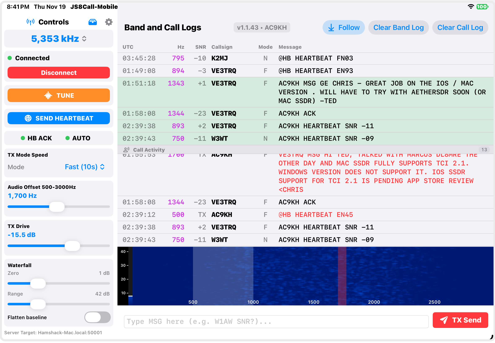

# JS8Call-Mobile

**User and Quick-Start Guide:**

*Coming soon to the Apple App Store for iPadOS and Mac*

**JS8Call-Mobile** is a full-featured amateur radio weak-signal digital mode client for iPadOS (and Mac Catalyst), built on the **JS8Core** engine. It allows licensed amateur radio operators to decode, compose, relay, and store-and-forward JS8 messages over a local network **TCI (Transceiver Control Interface)** connection or via direct iPad audio coupling.

* **Author:** Chris Olson (AC9KH)
* **License:** BSD 3-Clause (App) / MIT (JS8Core)
* **Privacy Policy:** [View Privacy Policy](PRIVACY.md)
* **Support & Bug Reports:** [GitHub Issues](https://github.com/Chris-AC9KH/JS8Call-Mobile/issues)

  

---

## Features

* **TCI Network Integration:** Connects directly over Wi-Fi/LAN to TCI-compatible Software Defined Radios (SDRs) and transceiver servers (such as ExpertSDR3, Thetis, and SunSDR), or FlexRadio with the open-source AetherSDR client for real-time VFO tuning, band preset switching, audio streaming, and PTT keying.
* **Local iPad Audio Mode:** Decode and transmit JS8 signals using your iPad's built-in microphone/speaker or an external USB/Lightning audio interface when TCI is disconnected. For keying of the rig with local audio it requires a radio that supports VOX trigger over USB audio, or a compatible USB->analog audio interface to the rig.
* **Split Band & Call Activity Panes:** Separates general band monitoring (**Band Activity**) from directed messages, `@ALLCALL` broadcasts, and your own transmissions (**Call Activity**).
* **Tap-to-Target QSOs & Command Helper:** Tap any incoming row in **Call Activity** to lock onto that station for a multi-turn QSO, or tap-and-hold (right-click on Mac) to open a categorized JS8 command helper menu.
* **Multi-Frame Assembly & Speed Modes:** Automatically assembles multi-frame JS8 transmissions in place with UTC timestamps, audio offset (`Hz`), signal-to-noise ratio (`SNR`), callsign, submode (`S`, `N`, `F`, `40`, `60`), and frame status indicators (`[incomplete]`, `[checksum failed]`). NOTE: JS8Call-Mobile only supports transmitting in Slow, Normal or Fast modes since VOX won't work reliably with JS8 40 and JS8 60 modes due to clipping of leading symbols when using a VOX trigger.
* **Store-and-Forward Inbox & Live Relays:** Full support for storing messages in a local SQLite inbox, multi-hop relay routing (`>`), automatic `RETRIEVE MSG` notifications, and full JS8 directed command auto-replies.
* **Live Waterfall & Passband Monitor:** Real-time spectrum waterfall (`500–3000 Hz`) with adjustable **Zero** floor, **Range**, **Flatten baseline** toggle, and visual TX audio offset marker.

---

## Quick Start Guide

### 1. Configure Your Station Identity
1. Tap the **Gear icon** (`⚙️`) in the top-right corner of the **Control Console** to open **Preferences and Settings**.
2. Enter your **Station Callsign** (e.g., `AC9KH`) and **Grid Square** (4 or 6 characters, e.g., `EN45`).
3. Tap **Done** to save. Your settings are stored locally on your iPad.

### 2. Choose Your Audio / Radio Connection
JS8Call-Mobile supports two operating modes:

* **Option A: TCI Network Connection (Recommended)**
  1. Open **Preferences and Settings** and enter your TCI server's **IP Address** (or `.local` hostname) and **Connection Port** (default `40001` or `50001`).
  2. Ensure **Use iPad audio when TCI is disconnected** is turned off. Only use this if you intend to use USB or mic/speaker audio.
  3. On the main **Control Console**, tap **Connect TCI**. The status dot will turn green (**Connected**) and your active VFO frequency will appear at the top.

* **Option B: Local iPad Audio Coupling**
  1. Open **Preferences and Settings** and enable **Use iPad audio when TCI is disconnected**.
  2. Grant microphone permission when prompted by iPadOS.
  3. Use a USB audio interface connected to your transceiver or acoustic coupling near your radio's speaker/mic.

---

## Control Console & Operating Guide

* **Frequency Readout & Band Selector:** Displays the active VFO frequency in `kHz` (e.g., `14,078 kHz`). Tap the frequency readout while connected to TCI to switch directly to standard JS8 dial frequencies across `160m` through `2m`.
* **Inbox (`📥`):** Opens your stored message inbox. A red badge displays the count of unread messages addressed to your callsign. You can compose outbound store-and-forward messages, read received messages, and manage stored traffic.
* **Connect TCI / Disconnect:** Opens or closes the network socket to your TCI server. A red **TX** badge appears next to the status indicator whenever the transmitter is keyed.
* **TUNE:** Transmits a continuous carrier tone at your selected **Audio Offset** frequency so you can tune an antenna tuner or verify RF output. Tap **TUNING...** again to stop *(requires active TCI connection, tune is disabled for iPad audio)*.
* **SEND HEARTBEAT:** Broadcasts an `@HB HEARTBEAT [GRID]` frame on a clear frequency automatically chosen inside the `500–950 Hz` heartbeat sub-band.
* **TX Mode Speed:** Selects your outbound transmit submode: **Slow (30s)**, **Normal (15s)**, or **Fast (10s)**. Incoming frames are decoded across all supported submodes (`S`, `N`, `F`, `40`, `60`).
* **Audio Offset (500–3000 Hz):** Sets your transmit audio tone frequency in 10 Hz steps, indicated by the vertical marker on the waterfall. Your offset remains locked where you set it for all directed transmissions and replies; only `@HB` broadcasts and `HEARTBEAT ACK` responses use the `500–950 Hz` heartbeat sub-band.
* **Waterfall Controls:**
  * **Zero:** Adjusts the minimum signal floor (`dB`) displayed on the waterfall.
  * **Range:** Adjusts the dynamic contrast range (`dB`) of incoming signals.
  * **Flatten baseline:** Normalizes passband tilt across the receiver filter width.
---

## Reading & Composing Messages

### Split Activity Logs
The main log view is divided into two synchronized panes sharing the same columns (`UTC`, `Hz`, `SNR`, `Callsign`, `Mode`, `Message`):

* **Band Activity (Top Pane):** Displays all decoded incoming traffic on the band.
  * **Green-tinted rows** highlight messages addressed directly to your callsign or relayed through your station.
  * **Orange text** indicates partial (`[incomplete]`) or corrupted (`[checksum failed]`) frames.
* **Call Activity (Middle Pane):** Filters traffic down to QSO-relevant activity: incoming messages addressed to you, `@ALLCALL` traffic, and your own outgoing transmissions.
  * **Red text** indicates your own outgoing transmissions (`TX`).
* **Follow / Clear Controls:**
  * **Follow** keeps both logs scrolled to the newest message (dragging either log manually pauses Follow until toggled back on).
  * **Clear Band Log** empties the top Band Activity pane.
  * **Clear Call Log** empties the middle Call Activity pane (and clears `AGN?` repeat history).

### Tap-to-Target & Command Helper
1. **Lock a Target Station:** Tap any incoming row in **Call Activity** to select that station. A blue **`To: CALLSIGN ×`** pill appears in the composition bar and stays locked across multi-turn exchanges until you tap **`×`**, tap the row again, or tap a different station.
2. **Long-Press Command Helper:** Tap and hold (or right-click on Mac) any incoming row in **Call Activity** to open a categorized menu of JS8 directed commands (`SNR?`, `GRID?`, `INFO?`, `STATUS?`, `HEARING?`, `AGN?`, `MSG`, `MSG TO:`, `>`, `QUERY CALL`, `QUERY MSGS`, `QUERY MSG`, plus quick `SNR` and `GRID` reports). Selecting a command locks the target callsign and populates the text entry box so you can review or append text before sending.
3. **Multi-Line Composition:** Type your message in the bottom bar and tap **TX Send** (or press **Return** on a hardware keyboard). The entry box expands vertically up to 5 lines as you type longer messages, and your station callsign prefix (`YOURCALL: `) is prepended automatically.

---

## Auto-Reply, Relays & Store-and-Forward Networking

Open **Preferences and Settings** to configure unattended or semi-automated station responses:

* **Enable Auto-Replies (AUTO):** When enabled, JS8Call-Mobile automatically responds to directed commands addressed to your callsign (or `@ALLCALL` queries where applicable) on your configured **Audio Offset**:
  * `[YOURCALL] SNR?` → Replies with the sender's signal report (`SNR +XX`).
  * `[YOURCALL] GRID?` → Replies with your configured Maidenhead grid square.
  * `[YOURCALL] INFO?` → Replies with your custom **INFO? Response Msg**.
  * `[YOURCALL] STATUS?` → Replies with your custom **STATUS? Response Msg**.
  * `[YOURCALL] HEARING?` → Replies with up to the 4 most recently heard callsigns (`HEARING CALL1 CALL2 CALL3 CALL4`).
  * `[YOURCALL] QUERY CALL [CALL]?` (or `@ALLCALL QUERY CALL [CALL]?`) → Replies with `YES [CALL] [SNR] [AGE]` if heard, or `NO` (for direct queries) if not heard.
  * `[YOURCALL] AGN?` → Re-transmits your most recent outgoing message to that station from **Call Activity**.
  * `[YOURCALL] MSG [TEXT]` / `MSG TO:[CALL] [TEXT]` → Stores the message in your local SQLite inbox and replies with `ACK`.
  * `[YOURCALL] QUERY MSGS` / `QUERY MSG [ID]` → Advertises (`YES MSG ID #`) and delivers stored messages addressed to the requesting station, marking them read upon `ACK`.
  * `[YOURCALL]>[NEXTHOP] [TEXT]` → Automatically forwards multi-hop relay frames along the specified callsign path and routes returning `ACK` confirmations back to the originator.
* **Push Retrieve Notices & Alerts:** When **Auto-Replies** is enabled, JS8Call-Mobile periodically notifies recently heard stations (`[CALL] RETRIEVE MSG [ID]`) if you are holding unread mail for them. When another station sends you a `RETRIEVE MSG` notice, an alert banner pops up with the exact `QUERY MSG` command needed to retrieve it.
* **Enable Heartbeat ACK:** Automatically responds to incoming `@HB` broadcasts with a signal report (`HEARTBEAT SNR +XX`) on a clear `500–950 Hz` sub-band offset, with a built-in **55-minute cooldown** per callsign to prevent duplicate QRM.
* **Hold PTT between frames of multi-frame messages:** Keeps the transmitter keyed continuously across frame boundaries during multi-frame transmissions instead of unkeying between frames. This only applies to TCI connected radios.

---

## URLs for App Store Connect & Settings

* **User Guide: this document**
* **Support:** via the issues list at [JS8Call-Mobile](https://github.com/Chris-AC9KH/JS8Call-Mobile/issues)
* **[Privacy Policy](https://github.com/Chris-AC9KH/JS8Call-Mobile/blob/main/PRIVACY.md)**
---

## Acknowledgments & Licenses

* **JS8Call-Mobile** is licensed under the **BSD 3-Clause License**. See [`LICENSE`](LICENSE) for full details.
* Built using **[JS8Core](https://github.com/JS8Call-improved/JS8Core)**, licensed under the **MIT License** (Copyright © 2025 js8core contributors, © 2018 Jordan Sherer, © 2026 JS8Call Official).

